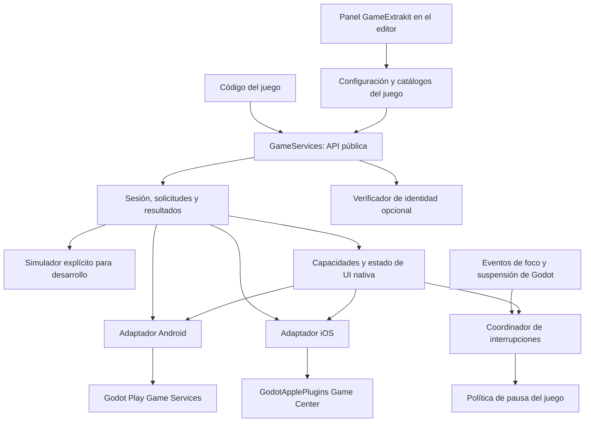

# GameExtrakit — Documento de desarrollo

Fecha del análisis: 2026-09-26.  
Proyecto: plugin reutilizable de servicios de juegos para Kmingame.  
Motor objetivo confirmado por el usuario: **Godot 4.7**.  
Estado: implementación inicial 0.1.0; validación local completada, validación nativa pendiente.  
Revisión de alcance: overlays nativos y uso exclusivo de las APIs ya expuestas por
las dos bibliotecas seleccionadas.

La implementación se encuentra en `addons/game_extrakit`. Las propuestas de este
documento se conservan como diseño de referencia; el contrato materializado, su
cobertura y las pruebas están en el [README](README.md) y el
[manual enlazado](addons/game_extrakit/documentation/README.md). Para integrar la
versión entregada consulta la [API vigente](addons/game_extrakit/documentation/api.md),
la [configuración completa](addons/game_extrakit/documentation/configuration.md) y la
[matriz de cobertura](addons/game_extrakit/documentation/coverage.md).

## 1. Propósito y acuerdos

GameExtrakit proporcionará una interfaz de configuración dentro del editor y una API
común para los juegos de Kmingame. El código del juego llamará a esa API y el plugin
ejecutará la operación mediante la biblioteca correspondiente a la plataforma:

- Android: `godot-sdk-integrations/godot-play-game-services`.
- iOS: el componente Game Center de `migueldeicaza/GodotApplePlugins`.

**El objetivo confirmado es compartir la API que consume el juego en Godot.** Cada
plataforma conservará sus servicios, cuentas, amigos, rankings, ventanas temporales,
interfaces nativas y almacenamiento. No se exige que los usuarios de Android e iOS
compartan datos o tengan resultados y comportamientos nativos idénticos.

La integración también facilitará las interfaces nativas que las bibliotecas permiten
abrir o configurar. En Apple incluye `GKAccessPoint` y Game Center Game Overlay. En
Android incluye las pantallas PGS expuestas y la convivencia con Sidekick cuando esté
disponible en la distribución del juego. El plugin no dibujará un overlay sustituto.

Ejemplo conceptual de uso, todavía no implementado:

```gdscript
var save_result = await GameServices.save_game("principal", datos)
var achievement_result = await GameServices.unlock_achievement("primera_victoria")
var score_result = await GameServices.submit_score("mejor_puntuacion", puntos)
```

Las claves del juego serán estables y legibles. Los identificadores nativos se
resolverán mediante la configuración del proyecto.

El nombre `GameServices` es una propuesta para la fachada pública. `GameExtrakit` es
el nombre del proyecto/directorio actual. Los nombres definitivos de clases y métodos
se fijarán antes de publicar la primera versión de la API.

### 1.1 Qué está confirmado y qué es propuesta

Confirmado por el usuario:

- Godot 4.7 como versión objetivo.
- Las dos bibliotecas indicadas como base de integración.
- Una interfaz para activar y configurar los servicios.
- Las 25 funcionalidades como objetivos funcionales; su cobertura real queda limitada
  por la API pública disponible y se declara por capacidad y plataforma.
- Enrutamiento hacia la plataforma correspondiente, sin exigir paridad de datos ni
  una experiencia nativa idéntica.
- Analizar antes de crear o afectar código.
- Guardar el análisis y el plan en este archivo.
- Integrar las interfaces nativas dentro de las posibilidades de las bibliotecas elegidas.
- No salir de sus APIs: sin un SDK adicional de Sidekick, puentes nativos nuevos ni
  ampliaciones de los wrappers para completar funciones ausentes.
- Investigar como mínimo si se puede pausar al abrir Sidekick mediante los eventos
  disponibles, distinguiendo observación directa de una interrupción genérica de Godot.

Propuestas de ingeniería pendientes de materialización:

- Fachada, adaptadores, modelos, nombres de API y estructura de carpetas.
- Operaciones asíncronas y resultados normalizados.
- Un servicio global pequeño para integración de plataforma.
- Catálogos de identificadores por juego.
- Un proveedor de simulación para desarrollo.
- Adaptación de las limitaciones de las dependencias mediante resultados honestos,
  disponibilidad explícita y coordinación dentro de GDScript.
- Límites iniciales de consultas y estrategia de conflictos.
- Coordinador de UI nativa e interrupciones con política de pausa por juego.

La creación de este documento no autoriza por sí sola la implementación, instalación
de dependencias, cambios en consolas de proveedores, publicación o exportación firmada.

## 2. Alcance funcional

El contrato se organiza en cinco áreas:

1. Identidad y autenticación.
2. Amigos autorizados.
3. Logros.
4. Leaderboards.
5. Cloud Save.

Se añade un área transversal: **interfaces nativas, capacidades e interrupciones**.
Utiliza las operaciones existentes para abrir las vistas y observar su estado cuando
sea posible; no introduce servicios de plataforma independientes.

La verificación de identidad contra un backend es una integración adicional de la
primera área. Un backend propio no es necesario para enrutar las demás operaciones
hacia Google Play Games o Game Center/Saved Games.

### 2.1 Exclusiones

Quedan fuera del contrato común inicial:

- Events de Google.
- Game Stats, Recall, Quests y otras funciones específicas ajenas al contrato.
- Control programático de Sidekick no expuesto por el wrapper: abrir, cerrar, ocultar
  o identificar directamente su estado. Su diagnóstico y prueba de convivencia sí
  forman parte del alcance.
- Incorporar `com.google.android.play:sidekick`, un tercer plugin o llamadas nativas
  directas para suplir las APIs ausentes de las bibliotecas seleccionadas.
- Implementar multiplayer, matchmaking, un sistema propio de retos, o administrar
  Challenges/Activities remotos. Se permite abrir sus destinos Apple y transmitir
  eventos ya expuestos por el binding como capacidades opcionales de esa plataforma.
- Compras, anuncios, analítica, notificaciones y Sign in with Apple independiente.
- Sincronización de partidas o cuentas entre Android e iOS.
- Rankings que mezclen jugadores de ambas plataformas.
- Creación automática de productos, logros, rankings o credenciales en las consolas
  de Google y Apple.
- Un editor de UI de gameplay. El panel solicitado es de configuración; el juego
  podrá construir su propia UI con los datos comunes o abrir las vistas nativas.

La autenticación Game Center no debe confundirse con el servicio independiente
Sign in with Apple. No se incorporará ese módulo para implementar el inicio de sesión
del jugador en Game Center.

### 2.2 Regla de alcance vigente

La restricción más reciente sustituye las propuestas anteriores de modificar el
wrapper Android. La implementación consumirá sus métodos, señales y propiedades
existentes, más las APIs normales de Godot para configuración y ciclo de vida.

- No se implementarán forks, resolutores nativos nuevos, señales nativas adicionales
  ni paginación que el wrapper no exponga.
- Las carencias encontradas se conservan como diagnóstico, no como trabajo nativo
  comprometido. Un método común puede devolver `UNSUPPORTED` en una plataforma.
- La verificación de identidad conserva el verificador de backend opcional del
  alcance original; no se añade otro backend para suplir overlays o funciones ausentes.
- Se pueden documentar prerrequisitos manuales de Play Console, App Store Connect y
  exportación. Eso no convierte sus APIs administrativas en dependencias del plugin.
- Las opciones específicas de Sidekick que requieran integración adicional fuera del
  exportador seleccionado quedan como referencia externa, sin generación automática.
- Si una versión futura de la misma biblioteca expone una capacidad, se revisará y
  validará antes de incorporarla. No se dará por disponible anticipadamente.

Con esta regla, el punto 25 permanece parcial en Android y la confirmación fiable del
punto 21 tiene una limitación del wrapper. La entrega debe declarar esas limitaciones,
sin afirmar cobertura completa de los 25 puntos en ambas plataformas.

## 3. Evidencia y estado de las dependencias

Se consultaron código fuente, documentación de los repositorios y documentación
oficial de los proveedores. Fue una revisión estática: no se compilaron bibliotecas,
no se exportaron juegos y no se ejecutaron pruebas en dispositivos.

La carpeta `D:/Proyectos/kmingame/plugins/GameExtrakit` estaba vacía antes de crear
este documento. No se encontró un proyecto Godot, código existente, `AGENTS.md`
aplicable ni un repositorio Git inicializado en esa ubicación.

| Dependencia | Referencia examinada | Observaciones |
|---|---|---|
| Android | Commit `e38b618578572b558691c4f476f70f5e142226ce` | `main` consultado; versión declarada 3.4.0. |
| Android | Release `v3.4.0`, publicada el 2026-07-20 | Activo publicado `addons.zip`; el binario no fue descargado ni validado. |
| Apple | Commit `a2ae65df061c80d66420e23572300cc9ffcedb7c` | `main` consultado, fechado el 2026-09-02. |
| Apple | Release `build-bfade13ff8b6027ede438bac637b5bf93057d404`, publicada el 2026-09-02 | Es una referencia distinta del commit de `main` examinado; no asumir que el binario contiene exactamente ese código. |

Para la revisión de Sidekick se inspeccionaron en memoria los 40 archivos `.kt` de
`plugin/src/main` y `.gd` de `addons/GodotPlayGameServices` en el commit Android fijado.
Se revisaron también el registro `signals/Signals.kt` y los callbacks públicos del
plugin. No se encontró una API o señal de visibilidad de Sidekick, ni una señal del
wrapper que traduzca foco/pausa/resume a estado de ese overlay. Los callbacks de
Activity revisados gestionan otras operaciones; no prueban apertura/cierre de Sidekick.
La documentación pública de Sidekick consultada tampoco aportó ese contrato. [R2], [R29], [R35].

Las páginas indexadas pueden corresponder a revisiones anteriores. Por ejemplo, la
revisión actual Android sí expone `setAchievementSteps`. Para implementar se debe
volver a comprobar el código de la referencia fijada, no depender de fragmentos
antiguos encontrados en un buscador.

### 3.1 Compatibilidad observada

- Android utiliza plugins de Godot 4 y un plugin de editor para integrar la exportación.
- Su `plugin/build.gradle.kts` examinado referencia Godot `4.5.1.stable`,
  `play-services-games-v2:21.0.0`, Java 17, `compileSdk = 35` y `minSdk = 21`.
- Esos valores describen la dependencia examinada; no fijan automáticamente los
  requisitos finales del juego ni prueban compatibilidad con Godot 4.7.
- El paquete Apple examinado declara iOS 17, macOS 14 y Swift tools 6.2 para compilar
  sus fuentes. La aplicación inicial del proyecto será iOS.
- El descriptor Game Center declara `compatibility_minimum = 4.2` y depende de
  `SwiftGodotRuntime` en iOS. Ese mínimo tampoco sustituye una prueba en Godot 4.7.
- Apple ofrece bibliotecas separadas. Se buscará distribuir Game Center y sus
  dependencias necesarias, evitando incorporar módulos ajenos al alcance.
- La exportación y validación iOS requieren el entorno Apple adecuado, incluido
  macOS/Xcode según el flujo oficial de Godot.

Antes de implementar, elegir un parche concreto de Godot 4.7 y usar editor y plantillas
de exportación coincidentes. No inferir que el usuario eligió específicamente 4.7.1.

Referencias: [R1], [R8], [R9], [R10], [R16], [R25].

## 4. Matriz completa de funcionalidades

"Disponible" significa que la operación está expuesta en el código revisado. No
equivale a estar probada en un dispositivo ni a disponer de errores y confirmaciones
suficientes para un contrato de producción.

| Nº | Funcionalidad esperada | Android | iOS / Apple | Trabajo de GameExtrakit |
|---|---|---|---|---|
| 1 | Autenticar y consultar sesión | `isAuthenticated`, `signIn` | `GameCenterManager.authenticate`, estado de `GKLocalPlayer` | Estado común, inicialización, interacción y cambios de sesión. |
| 2 | Identidad y perfil básico | `loadCurrentPlayer` | `GKLocalPlayer` / `GKPlayer` | Modelo común con ID opaco, proveedor y nombre; campos adicionales opcionales. |
| 3 | Verificar identidad contra backend | `requestServerSideAccess` | `fetch_items_for_identity_verification_signature` | Obtener evidencia específica y delegar su verificación real al backend configurado. |
| 4 | Lista de amigos autorizados | `loadFriends` con tamaño de página y solicitud de permiso | `load_friends` y estado de autorización | Modelo común y completitud explícita; sin prometer continuación Android no expuesta. |
| 5 | Desbloquear logros | `unlockAchievement` para logros normales | Reportar logro al 100 % | Resolver clave interna y distinguir logros normales/incrementales en Android. |
| 6 | Progreso de logros | `setAchievementSteps`, `incrementAchievement` | Porcentaje en `GKAchievement` | Progreso absoluto 0–1, conversión a pasos/porcentaje y comportamiento monotónico. |
| 7 | Consultar progreso de logros | `loadAchievements` | `GKAchievement.load_achievements` | Estado normalizado y tratamiento de logros sin progreso reportado. |
| 8 | Consultar definiciones de logros | Metadatos de `loadAchievements` | `GKAchievementDescription` | Separar definición de estado, permitir campos y recursos visuales ausentes. |
| 9 | Mostrar UI nativa de logros | `showAchievements` | `GKAccessPoint` / `GKGameCenterViewController` | Apertura y estado observado cuando exista; los callbacks y destinos dependen de la API utilizada. |
| 10 | Enviar puntuación | `submitScore` | `GKLeaderboard.submit_score` | Mapear ID, validar entero/unidad y normalizar finalización. |
| 11 | Listar leaderboards | `loadAllLeaderboards`, `loadLeaderboard` | `GKLeaderboard.load_leaderboards` | Catálogo normalizado y distinción entre claves configuradas e IDs descubiertos. |
| 12 | Puntuación y rank propios | `loadPlayerScore` | Entrada local obtenida al consultar leaderboard | Entrada opcional: sin puntuación es diferente de error. |
| 13 | Top N | `loadTopScores` | Consulta de rango desde la primera posición | Límite documentado; propuesta inicial N entre 1 y 25. |
| 14 | Puntuaciones alrededor del jugador | `loadPlayerCenteredScores` | Consultar rank y luego rango de entradas | Operación compuesta iOS, límites y jugador todavía sin rank. |
| 15 | Ranking global | `COLLECTION_PUBLIC` | `PlayerScope.global` | Enum común `GLOBAL` con semántica nativa. |
| 16 | Ranking de amigos | `COLLECTION_FRIENDS` | `PlayerScope.friendsOnly` | Enum común `FRIENDS` y errores de autorización. |
| 17 | Período diario/corto | `TIME_SPAN_DAILY` | `TimeScope.today` | Enum común `DAILY`; conservar calendario nativo. |
| 18 | Período semanal | `TIME_SPAN_WEEKLY` | `TimeScope.week` | Enum común `WEEKLY`; conservar calendario nativo. |
| 19 | Histórico | `TIME_SPAN_ALL_TIME` | `TimeScope.allTime` | Enum común `ALL_TIME`. |
| 20 | Mostrar UI nativa de rankings | Vistas de uno/todos y filtros | `GKAccessPoint` / `GKGameCenterViewController` | Apertura común; nunca identificar la pantalla PGS como apertura de Sidekick. |
| 21 | Guardar partida | `saveGame`, con señal prematura de éxito | `save_game_data` | Bytes y slots; en Android declarar finalización no verificable con esa señal, sin cambiar el wrapper. |
| 22 | Cargar partida | `loadGame` | Buscar saved game y llamar `load_data` | Cargar sin crear implícitamente una partida inexistente. |
| 23 | Enumerar partidas | `loadSnapshots` | `fetch_saved_games` | Lista de slots y metadatos opcionales. |
| 24 | Eliminar partida | `deleteSnapshot` por ID nativo | `delete_saved_games` por nombre | Resolver slot al identificador requerido; explicar alcance de eliminación. |
| 25 | Detectar y resolver conflictos | Señal de conflicto y políticas internas; sin resolver público | Listener y `resolve_conflicting_saved_games` | Detección disponible; resolución explícita Apple y `UNSUPPORTED` Android. |

Fuentes de la matriz: [R2], [R3], [R4], [R5], [R6], [R11], [R12], [R13],
[R14], [R15], [R18], [R19].

## 5. Hallazgos que condicionan la implementación

### 5.1 Resolución de conflictos Android incompleta

En `SnapshotsProxy.kt`:

- `saveGame` abre el snapshot con `RESOLUTION_POLICY_HIGHEST_PROGRESS`.
- `loadGame` lo abre con `RESOLUTION_POLICY_MOST_RECENTLY_MODIFIED`.
- Si el SDK entrega un conflicto, se emite `conflictEmitted`.
- No se encontró una operación pública de resolución en `GodotAndroidPlugin.kt`
  ni en el cliente GDScript de snapshots examinado.

Consecuencia: una fachada GDScript puede detectar algunos conflictos, pero no puede
ofrecer una resolución completa elegida por el juego utilizando solamente la API
actual del wrapper. Además, las políticas automáticas pueden resolver conflictos
antes de que nuestra capa los vea.

Tratamiento dentro del alcance vigente:

1. Comunicar los conflictos que el wrapper efectivamente emita; no prometer interceptar
   los que haya resuelto mediante sus políticas internas.
2. Marcar `can_resolve_save_conflicts = false` para el adaptador Android examinado.
3. Devolver `UNSUPPORTED` al solicitar resolución Android, sin sobrescribir o eliminar
   datos para simular una resolución.
4. Conservar el respaldo local del juego y el contexto del conflicto para diagnóstico.
5. No ofrecer en el panel una política Android que la API pública no permita cambiar.

En Apple ya existen registro del listener y resolución explícita. El adaptador deberá
conservar los objetos `GKSavedGame` implicados mientras el token sea válido.

Esta limitación impide declarar completo el punto 25 en Android. Añadir el resolutor
nativo queda fuera del alcance actual. Fuentes: [R2],
[R3], [R7], [R12], [R23].

### 5.2 Confirmación prematura del guardado Android

El código examinado llama a `commitAndClose` y a continuación emite `gameSaved(true, …)`
sin esperar el resultado de esa tarea. También hay rutas de fallo que solamente se
registran y no producen una respuesta completa hacia Godot.

Consecuencia: el juego puede recibir una indicación de éxito antes de conocer si la
operación del proveedor terminó correctamente.

Tratamiento dentro del alcance vigente:

- No cambiar `SnapshotsProxy` ni añadir callbacks de commit.
- Conservar la señal recibida como información del wrapper, pero devolver un resultado
  `UNKNOWN` respecto a la finalización real si no existe evidencia más fuerte.
- Marcar `can_confirm_save_completion = false` para el adaptador Android examinado.
- No transformar esa señal en `PROVIDER_ACCEPTED` o `SYNC_CONFIRMED`.
- Una lectura posterior puede devolver datos de cache y no prueba sincronización remota.
- Informar timeouts y fallos conocidos sin inventar errores que el wrapper omita.
- Resolver una sola vez cada espera local, manteniendo el límite de certeza documentado.

Esperar el commit en el código nativo sería una corrección del proveedor, pero no se
incluye como modificación propia bajo la restricción actual.

Fuente: [R3].

### 5.3 Señales Android ambiguas o insuficientes

En logros incrementales, `achievementUnlocked(false, id)` puede representar un avance
exitoso que todavía no desbloquea el logro, o un error de la operación. Algunas
consultas convierten un fallo en `null` o una lista vacía. Varias señales no incluyen
la totalidad de los parámetros que identifican una consulta.

La fachada no puede recuperar información que la dependencia descartó.

Propuesta:

- Separar en el modelo común el estado de desbloqueo del éxito conocido de la operación.
  Cuando la señal sea ambigua, el éxito será desconocido.
- No añadir información de error ni IDs al puente nativo. Los IDs internos coordinan
  esperas locales, pero no recuperan correlación que la dependencia nunca expuso.
- Mientras falte correlación, serializar operaciones que produzcan respuestas
  indistinguibles; no asumir que basta con serializar por todos los parámetros de
  entrada si la señal solamente devuelve el ID del leaderboard.
- Después de un timeout, una respuesta tardía no se debe asignar a la siguiente
  solicitud. Si no se puede aislar con la API existente, bloquear/degradar ese canal
  indistinguible y documentar su recuperación. Una demora arbitraria no demuestra
  que ya no llegará la respuesta antigua.
- Una limitación temporal del proveedor debe declararse como tal; no inventar un
  error preciso o un éxito para completar el resultado común.

Fuentes: [R4], [R5], [R6].

### 5.4 Límites de ranking y amigos

Las consultas Android de Top N y alrededor del jugador aceptan entre 1 y 25 entradas
por solicitud. El SDK dispone de operaciones de continuación, pero el wrapper
examinado no las expone. La consulta de amigos también solicita una página sin exponer
en su API pública examinada una continuación completa.

Propuesta inicial:

- Limitar Top N y alrededor del jugador a 25 resultados solicitados.
- Rechazar tamaños no soportados con un error explícito; no recortarlos silenciosamente.
- Devolver información de completitud cuando se pueda conocer.
- No prometer «todos los amigos» si solo se obtuvo una página.
- Las listas completas de amigos y Top N mayor de 25 no quedan garantizados en
  Android. No añadir paginación nativa para completar esas variantes.

El límite de 25 para la primera versión es una recomendación, no una decisión ya
aprobada por el usuario. Fuentes: [R2], [R5], [R6], [R18], [R21].

### 5.5 Ventanas temporales nativas

Google documenta reinicio diario a medianoche en UTC-7 y semanal entre sábado y
domingo en esa misma zona. Apple describe `today` como las últimas 24 horas y `week`
como la última semana.

La API puede ofrecer `DAILY`, `WEEKLY` y `ALL_TIME` como intenciones comunes. No
necesita modificar calendarios para cumplir el alcance confirmado. La documentación
del plugin explicará la semántica por proveedor y evitará prometer una hora de cierre
compartida o temporadas sincronizadas.

Fuentes: [R19], [R20].

### 5.6 Identidad y verificación de servidor

Android devuelve un código de autorización para uso server-side. Apple devuelve los
componentes de una firma de verificación. Ninguno debe interpretarse en el cliente
como una verificación ya completada por Kmingame.

El flujo será:

1. Autenticar al jugador con su plataforma.
2. Solicitar la evidencia correspondiente.
3. Enviarla al verificador configurado mediante el canal seguro definido por el backend.
4. Recibir la respuesta del servidor y, si procede, una sesión propia de Kmingame.

El formato de evidencia será una unión explícita por proveedor, no un supuesto JWT
común. En Apple la verificación requiere campos adicionales como Bundle ID y el
identificador de jugador que corresponda al mecanismo de firma. La documentación
actual indica `teamPlayerID`, con una excepción para Apple Arcade. El ID de perfil
mostrado por la fachada no se debe sustituir indiscriminadamente por el ID firmado.

El servidor debe validar la evidencia según el proveedor, su frescura y el contexto
de aplicación. Los nombres visibles del jugador no constituyen evidencia firmada.
Los secretos OAuth y las credenciales de administración permanecen en el servidor.

Fuentes: [R22], [R24], [R26].

### 5.7 UI nativa: equivalencia conceptual y API efectiva

Apple llama Game Overlay a su interfaz y permite acceder mediante `GKAccessPoint`.
El binding seleccionado expone activación del acceso, posición, highlights, consulta
de presentación y destinos específicos. La UI la dibuja el sistema. [R27], [R28].

Sidekick es una superficie gestionada por Google cuya incorporación y visibilidad
dependen de distribución y preferencias. El wrapper PGS seleccionado expone pantallas
de logros/rankings, pero no abrir/cerrar Sidekick ni consultar si está abierto. No se
añadirá el SDK separado de Sidekick para investigar o suplir esta carencia. [R2], [R29], [R30].

No se considera una intersección garantizada de ambos overlays que muestren todos los
amigos activos, retos, actividades, perfiles o rankings del mismo modo. Tampoco se
confunde abrir una pantalla PGS con abrir Sidekick.

En Apple, varios accesos específicos del binding requieren iOS 18 y los de Challenges,
Friending, Play Together y Activities requieren iOS 26. Algunas rutas de versiones
anteriores no ejecutan acción ni callback. Comprobar disponibilidad antes de llamar,
devolver `UNSUPPORTED` si procede y no dejar una espera pendiente. El mínimo iOS 17
del paquete no habilita automáticamente todas sus funciones. [R27], [R28].

La propiedad `active` controla el punto de acceso y `visible` su visibilidad;
`is_presenting_game_center` representa la presentación de Game Center. Son estados
distintos. Ocultar el acceso no implica cerrar una presentación abierta.

La detección de interrupciones Android y la política de pausa se especifican en 9.1;
su comprobación en dispositivos forma parte de 13.7.

## 6. Arquitectura propuesta



### 6.1 Responsabilidades

| Componente | Responsabilidad |
|---|---|
| Plugin del editor | Panel, edición de configuración, validadores y coordinación de exportación. |
| Configuración | Proveedores y módulos activos, IDs públicos, catálogos y opciones por juego. |
| Fachada pública | Contrato consumido por gameplay, validación de argumentos y resolución de claves. |
| Coordinador | Inicialización, estado de autenticación, solicitudes, timeouts, resultados tardíos y eventos. |
| Adaptador Android | Traducción a la biblioteca Android y conversión de sus resultados. |
| Adaptador iOS | Traducción a Game Center/Saved Games, operaciones compuestas y callbacks. |
| Modelos comunes | Datos tipados de dominio, sin clases nativas en sus propiedades públicas. |
| Simulador | Respuestas reproducibles, latencia, fallos, cuentas y conflictos de prueba. |
| Verificador opcional | Contrato para conectar la verificación de identidad con el backend del juego. |
| Coordinador de UI nativa | Destinos disponibles y estado observado mediante las APIs existentes. |
| Coordinador de interrupciones | Eventos de Godot y presentación Apple; motivos de pausa independientes. |

### 6.2 Límites y dependencias

- La lógica de gameplay no consultará `OS.get_name()` para cada operación de servicios.
- La selección del proveedor se hará durante inicialización según plataforma,
  configuración y disponibilidad real de la dependencia.
- La presencia de stubs de Apple en Windows no significa disponibilidad de Game Center.
- La simulación debe habilitarse explícitamente y distinguirse del servicio real.
- En una plataforma no soportada, devolver `UNSUPPORTED_PLATFORM`; no fingir éxito.
- Una capacidad deshabilitada devolverá `FEATURE_DISABLED`.
- Un proveedor habilitado pero no instalado devolverá `DEPENDENCY_MISSING`.
- Evitar referencias a tipos nativos en scripts comunes que impidan abrir el proyecto
  cuando una dependencia opcional esté ausente. Validar carga y registro de adaptadores
  en todos los entornos del editor y de exportación.
- Los adaptadores traducen operaciones; no deciden reglas de progreso, economía o
  fusión de inventarios del juego.
- Sidekick no será un proveedor de datos ni un SDK añadido. Su estado directo será
  desconocido cuando la biblioteca seleccionada no permita observarlo.
- Los eventos generales de Godot son herramientas del motor para pausar, no una
  ampliación de la API de plataforma ni evidencia de qué aplicación causó la interrupción.
- Un servicio global pequeño puede justificarse para esta integración. No convertirá
  GameExtrakit en propietario del estado completo de la partida.
- El panel y el runtime tendrán ciclos de vida separados. Desactivar el plugin de
  editor debe limpiar registros, paneles y elementos que realmente haya instalado.

### 6.3 Estructura de archivos orientativa

La siguiente estructura es una propuesta, no una lista de archivos ya creados:

```text
addons/game_extrakit/
    plugin.cfg
    editor/
        game_extrakit_plugin.gd
        game_extrakit_dock.tscn
        game_extrakit_dock.gd
        configuration_validator.gd
        export_coordinator.gd
    runtime/
        game_services.gd
        request_coordinator.gd
        session_state.gd
        native_ui_coordinator.gd
        interruption_coordinator.gd
        adapters/
            platform_adapter.gd
            android_adapter.gd
            apple_adapter.gd
            mock_adapter.gd
        models/
        identity/
    configuration/
        game_services_config.gd
        achievement_definition.gd
        leaderboard_definition.gd
    documentation/
    THIRD_PARTY_NOTICES.md
demo/
tests/
plugindev.md
```

La ubicación final de los adaptadores opcionales y de las dependencias se decidirá
según las rutas requeridas por sus paquetes. No mover bibliotecas arbitrariamente:
los descriptores y scripts del proveedor pueden contener rutas absolutas de recurso
`res://addons/...`.

## 7. Contrato de API propuesto

Las firmas siguientes describen intención. Antes de implementar se fijarán clases,
tipos y documentación de GDScript válidos para Godot 4.7. Los ejemplos anteriores
suponen que la fachada encapsula la espera hasta obtener un resultado final.

### 7.1 Inicialización y disponibilidad

| Operación | Resultado / comportamiento |
|---|---|
| `initialize(config)` | Selecciona proveedor, valida dependencias y prepara clientes. |
| `get_provider()` | `ANDROID_PGS`, `APPLE_GAME_CENTER`, `MOCK` o `NONE`. |
| `get_capabilities()` | Capacidades implementadas, límites y disponibilidad conocida. |
| `get_auth_state()` | Estado local observado de autenticación. |
| `refresh_auth_state()` | Actualiza estado mediante el mecanismo que admita el proveedor. |
| `authenticate()` | Solicita autenticación e interacción nativa cuando corresponda. |

No prometer que ambos proveedores ofrecen una comprobación silenciosa independiente
con exactamente el mismo comportamiento. Separar disponibilidad del SDK de sesión
autenticada. No añadir un `logout()` universal sin verificar que las dos bibliotecas
lo permitan con un significado adecuado.

### 7.2 Identidad y amigos

| Operación | Resultado conceptual |
|---|---|
| `get_player()` | `PlayerResult`. |
| `get_identity_proof()` | `IdentityProofResult` con proveedor y evidencia específica. |
| `verify_player_identity()` | `IdentityVerificationResult` del backend configurado. |
| `list_friends(options)` | `FriendsResult` con datos y completitud conocida/desconocida. |

Sin verificador configurado, `verify_player_identity()` devolverá
`BACKEND_NOT_CONFIGURED`; obtener evidencia puede seguir disponible si la plataforma
está configurada para ello. El backend y su endpoint aún no han sido proporcionados.

### 7.3 Logros

| Operación | Resultado conceptual |
|---|---|
| `unlock_achievement(key)` | Estado de la operación y estado de desbloqueo. |
| `set_achievement_progress(key, progress)` | Progreso absoluto normalizado observado/aceptado. |
| `list_achievement_definitions(options)` | Definiciones y metadatos. |
| `list_player_achievements(options)` | Estado del jugador por logro. |
| `show_achievements()` | Estado de la solicitud de apertura de UI nativa. |

Decisiones de normalización propuestas:

- `progress` pertenece a `[0.0, 1.0]`; rechazar valores inválidos y no finitos.
- Para un logro incremental Android, convertir usando `total_steps`. Propuesta:
  `floor(progress * total_steps)`; `1.0` corresponde exactamente al total.
- La cuantización significa que la plataforma puede conservar un progreso inferior
  al solicitado por menos de un paso. No inventar precisión inexistente.
- No enviar cero pasos si el SDK requiere un valor positivo; resolver el caso como
  ausencia de avance según el estado conocido, sin alterar el servicio.
- Reportar progreso absoluto monotónico. Reenviar el mismo valor no deberá añadir
  pasos extra. Una solicitud menor no debe reducir el progreso nativo.
- Desbloquear un logro incremental debe usar el mecanismo apropiado para completar
  pasos; no enviar sin distinción el método de logros normales.
- Mantener separado el éxito de la operación y que el logro esté desbloqueado.
- Apple puede devolver solamente logros con progreso reportado. Combinar con las
  definiciones para representar los demás con progreso inicial cuando corresponda.
- IDs no configurados o metadatos incompatibles producirán un error de configuración.

Fuente de las diferencias de progreso y consulta: [R4], [R11].

### 7.4 Leaderboards

| Operación | Resultado conceptual |
|---|---|
| `list_leaderboards(options)` | Definiciones del servicio activo. |
| `submit_score(key, score)` | Resultado de envío; no implica nuevo récord. |
| `get_player_score(key, query)` | Entrada propia opcional. |
| `get_top_scores(key, query)` | Lista de entradas y contexto de consulta. |
| `get_scores_around_player(key, query)` | Lista cercana, entrada propia y condición de centrado. |
| `show_leaderboards(options)` | Solicitud de apertura de listado nativo. |
| `show_leaderboard(key, query)` | Solicitud de apertura de un ranking nativo. |

`query` contendrá alcance `GLOBAL`/`FRIENDS`, período `DAILY`/`WEEKLY`/`ALL_TIME`,
límite y preferencia de actualización cuando pueda ser atendida.

Reglas:

- Los enteros de enums comunes se traducen expresamente; no reutilizar valores
  numéricos de un SDK suponiendo que coinciden con el otro.
- `score` será entero de 64 bits. Unidades y orden se configuran coherentemente con
  los rankings creados en cada consola.
- Probar preservación de enteros grandes al atravesar JSON o puentes nativos.
  Una posible pérdida de precisión es un riesgo por verificar, no un defecto confirmado.
- Usar el rank proporcionado por el proveedor. No reconstruirlo como índice de array;
  pueden existir empates o posiciones ausentes.
- En iOS, la consulta cercana puede requerir dos llamadas. El ranking puede cambiar
  entre ambas; no prometer una instantánea atómica.
- Android documenta que puede devolver el Top cuando el jugador carece de puntuación.
  Propuesta: conservar ese resultado e indicar `centered_on_player = false`, con
  comportamiento equivalente en el adaptador iOS si se adopta este fallback.
- Un listado vacío y una consulta fallida son resultados diferentes.
- `force_refresh` es una petición al proveedor; si no tiene equivalente, documentar
  el alcance real en vez de prometer frescura forzada.

Fuentes: [R5], [R13], [R18].

### 7.5 Cloud Save

| Operación | Resultado conceptual |
|---|---|
| `save_game(slot, data, options)` | `SaveResult`, con estado de aceptación/sincronización conocido. |
| `load_game(slot)` | `LoadResult` con bytes o `SAVE_NOT_FOUND`. |
| `list_saved_games(options)` | `SavedGamesResult`. |
| `delete_saved_game(slot)` | Resultado de eliminación del slot correspondiente. |
| `resolve_save_conflict(token, data)` | Resolución Apple; `UNSUPPORTED` Android con el wrapper fijado. |

Reglas:

- `data` será un `PackedByteArray` de contenido opaco.
- El juego decide qué serializar y cómo migrar su esquema. No serializar nodos ni
  imponer un formato de partida universal.
- El plugin valida slot, tamaño y disponibilidad; el juego valida su contenido.
- Definir límites compatibles con los proveedores al implementar, consultando la
  documentación vigente. No fijar un tamaño máximo inventado en este documento.
- Mapear slot lógico a nombre remoto. Para eliminar en Android, resolver también
  el ID nativo del snapshot; en Apple la operación se realiza por nombre.
- Una carga no debe crear silenciosamente un guardado inexistente.
- Definir si eliminar un nombre incluye todas sus versiones en conflicto y reflejarlo
  en el contrato. No tratar esas versiones como slots independientes por accidente.
- Los metadatos Android de descripción, tiempo jugado y progreso no tienen todos
  equivalentes nativos Apple. Los campos comunes correspondientes serán opcionales.
- Si se desea transportar metadatos adicionales dentro del payload, diseñar un
  sobre versionado explícito. No envolver o modificar bytes del juego de forma oculta.
- No confundir guardado local de respaldo con guardado en nube completado.
- La resolución automática por mayor progreso o fecha puede perder cambios válidos
  como compras internas de inventario o consumo de recursos. La lógica de fusión
  pertenece al juego.

En Apple se puede emitir el conjunto de versiones y esperar la resolución del juego,
manteniendo los objetos nativos y un token ligado a la sesión. En Android se comunica
el conflicto observado y la ausencia de resolución pública, sin abrir un flujo de
selección que no pueda completarse. No se cambian sus políticas nativas internas.

En Apple, Saved Games depende de la cuenta de iCloud y de iCloud Drive. No asumir
que cambiar la cuenta de Game Center implica cambiar automáticamente el almacén de
iCloud. Probar esa combinación y evitar asociar datos a una identidad incorrecta.
Fuente: [R23].

### 7.6 Interfaces nativas y observación

| Operación propuesta | Alcance real |
|---|---|
| `get_native_ui_capabilities()` | Devuelve soporte por destino, versión y método de observación, independientemente de que una UI esté visible. |
| `get_native_ui_state()` | Estado `PRESENTING`, `NOT_PRESENTING` o `UNKNOWN`, con origen y momento de observación. |
| `show_platform_overlay()` | Usa `GKAccessPoint.trigger` en Apple; `UNSUPPORTED` para Sidekick Android. |
| `set_platform_entry_point_visible(enabled)` | Configura `active` del access point Apple; `UNSUPPORTED` Android. No cierra un overlay abierto. |
| `set_platform_entry_point_location(location)` | Usa las ubicaciones expuestas en Apple; sin control runtime Android. |
| `show_achievements()` / `show_leaderboard(key, query)` | Conserva las pantallas existentes de cada biblioteca; el resultado identifica el destino solicitado. |
| `show_native_destination(destination, options)` | Opcional: solo destinos ya expuestos, como Challenges/Activities Apple en versiones compatibles. No crea retos ni partidas. |
| `get_interruption_state()` | Foco, suspensión y presentación conocida; no afirma qué overlay causó una pérdida de foco. |

Capacidades mínimas del modelo:

- `can_open_platform_overlay`: Apple sí; Android no en la API examinada.
- `can_control_entry_point`: Apple sí; Android no en la API examinada.
- `can_observe_platform_overlay`: Apple mediante propiedad; Android no en la API examinada.
- `has_overlay_visibility_signal`: no asumirla; el binding Apple expone una propiedad
  consultable, no una señal Godot de cambio en el archivo revisado.
- `can_open_achievements` y `can_open_leaderboards`: según dependencia y sesión.
- `available_native_destinations`: lista filtrada por sistema y configuración.
- `interruption_observation`: `PROVIDER_PROPERTY`, `GODOT_LIFECYCLE` o `UNAVAILABLE`.

No se añadirá `is_sidekick_open()` devolviendo `false` cuando falte información.
El estado del overlay Android permanece `UNKNOWN` aunque Godot informe foco recuperado.
La capacidad de detectar una interrupción no equivale a detectar Sidekick.

Los eventos entrantes Apple ya expuestos, como `game_activity_wants_to_play`, pueden
traducirse a un evento del juego y quedar pendientes hasta que este esté listo.
No se cargan escenas automáticamente ni se implementa lógica de retos. El binding
examinado confirma recepción nativa antes de que el juego decida cómo manejarla;
no prometer una aceptación/rechazo diferido que su API no permita. [R12].

## 8. Modelos de datos y resultados

La API pública utilizará modelos tipados. Los diccionarios o JSON de terceros se
validarán al entrar al adaptador y no circularán por todo el juego sin contrato.

| Modelo | Campos conceptuales mínimos |
|---|---|
| `PlayerProfile` | Proveedor, ID opaco, ámbito del ID, nombre visible; avatar/datos adicionales opcionales. |
| `IdentityProof` | Proveedor, tipo de evidencia y payload específico de verificación. |
| `FriendProfile` | Perfil básico y campos disponibles; no inferir relaciones no confirmadas. |
| `AchievementDefinition` | Clave local opcional, ID nativo, nombre, descripción, tipo y total de pasos cuando aplique. |
| `AchievementState` | ID, progreso normalizado, desbloqueado y metadatos disponibles. |
| `LeaderboardDefinition` | Clave local opcional, ID nativo, nombre y configuración conocida. |
| `LeaderboardEntry` | Jugador, score entero, texto formateado opcional y rank del proveedor. |
| `SavedGameMetadata` | Slot, ID nativo cuando exista, fecha y metadatos opcionales. |
| `SaveConflict` | Token opaco, slot, proveedor, versiones disponibles y generación de sesión. |
| `ServiceError` | Código común, mensaje, proveedor, diagnóstico nativo opcional y contexto. |
| `NativeUiState` | Estado observado, proveedor, destino conocido opcional, fuente y timestamp. |
| `InterruptionState` | Motivos independientes: foco, suspensión y presentación confirmada; sin identificar Sidekick por inferencia. |

### 8.1 Resultado de operaciones

Cada resultado incluirá:

- `request_id`: correlación de la solicitud, al menos dentro del runtime común.
- `status`: `OK`, `FAILED`, `CANCELLED`, `UNSUPPORTED` o `UNKNOWN`.
- Datos tipados cuando existan.
- Error y código nativo cuando se conozcan.
- Proveedor y contexto necesario de la operación.

`UNKNOWN` se reserva para casos como una escritura cuyo resultado se perdió o cuya
finalización no se puede verificar con la señal del wrapper. No es
equivalente a «falló» ni autoriza reintentos que puedan duplicar efectos.

En guardado se agregará un estado de entrega, si hay evidencia:

- `PROVIDER_ACCEPTED`: la operación fue aceptada/finalizada según el SDK.
- `PENDING_SYNC`: el proveedor informa que queda sincronización pendiente.
- `SYNC_CONFIRMED`: solamente cuando una API permita verificarlo realmente.
- `UNKNOWN`: no se puede determinar.

No todos los proveedores permitirán distinguir esos estados. No sintetizarlos a
partir de un booleano que no tenga ese significado.

En el wrapper Android fijado, `gameSaved(true, …)` es insuficiente para confirmar
commit: `status` y entrega permanecerán `UNKNOWN`, conservando el reporte nativo como
diagnóstico. No se anunciará «guardado completado» basándose exclusivamente en él.

Errores comunes propuestos:

```text
NOT_INITIALIZED
UNSUPPORTED_PLATFORM
FEATURE_DISABLED
DEPENDENCY_MISSING
INVALID_CONFIGURATION
INVALID_ARGUMENT
UNSUPPORTED_OPERATION
NOT_AUTHENTICATED
AUTHENTICATION_FAILED
PERMISSION_REQUIRED
PERMISSION_DENIED
USER_CANCELLED
NETWORK_UNAVAILABLE
TIMEOUT
PROVIDER_ERROR
SAVE_NOT_FOUND
CONFLICT_PENDING
CONFLICT_EXPIRED
BACKEND_NOT_CONFIGURED
IDENTITY_VERIFICATION_FAILED
```

Solo mapear un error específico si la evidencia nativa lo permite. Conservar una
categoría general cuando la biblioteca no comunique más detalle.

### 8.2 Eventos

Eventos propuestos, además del retorno de operaciones:

- Cambio de autenticación.
- Cambio de jugador/proveedor activo.
- Cambio de disponibilidad de capacidades.
- Conflicto de guardado detectado.
- Modificación remota de un guardado, donde el proveedor lo exponga.
- `native_ui_state_changed`: cambios observados de estado específico, si hay fuente.
- `interruption_changed`: foco/suspensión o presentación conocida, con motivo.
- Solicitud entrante de actividad nativa ya expuesta por el binding Apple.

Una señal global sirve para comunicar hechos; no debe ser el único mecanismo para
adivinar qué solicitud terminó. No prometer detección de modificaciones remotas
idéntica en ambas plataformas.

## 9. Estado, concurrencia y ciclo de vida

Estados conceptuales del runtime:

```text
UNINITIALIZED → INITIALIZING → READY
                         ↘ UNAVAILABLE

Autenticación dentro del proveedor disponible:
UNKNOWN → AUTHENTICATING → AUTHENTICATED
                      ↘ UNAUTHENTICATED
```

Permisos y disponibilidad de Cloud Save se modelan aparte; una sesión autenticada no
garantiza que todos los servicios estén listos.

Requisitos:

- No inicializar SDKs ni presentar autenticación repetidamente por cada llamada.
- Coordinar las operaciones que necesiten una misma inicialización o autenticación.
- No disparar UI de permisos desde una consulta supuestamente silenciosa.
- Usar una generación de sesión para descartar resultados de un jugador anterior.
- Invalidar caches de perfil, amigos, logros y handles de conflictos cuando cambie
  la identidad relevante.
- Serializar mutaciones de un mismo slot y evitar que una respuesta antigua pise
  una carga o escritura más reciente.
- Gestionar suspensión, reanudación, cancelación y cierre de la aplicación.
- Cancelar una espera local no significa que el proveedor haya cancelado la operación.
- No acceder al árbol de escenas desde callbacks en hilos no permitidos. Auditar el
  hilo real de callbacks de ambos bindings y su mecanismo de despacho al motor.
- Registrar listeners una vez y liberarlos de acuerdo con el ciclo de vida.
- No bloquear el hilo principal esperando red.
- Evitar reintentos automáticos genéricos. Preferir operaciones idempotentes y
  revalidar estado cuando una mutación tenga resultado desconocido.
- Evitar cache indefinida. Documentar origen/frescura solamente cuando se conozcan.

La revisión actual no demuestra la seguridad de hilos de todos los callbacks Apple.
Ese punto queda como auditoría pendiente, no como defecto confirmado.

### 9.1 Detección del overlay y pausa sin nuevas APIs nativas

**Apple: observación directa disponible.** Consultar
`access_point.is_presenting_game_center` a través del binding seleccionado. Se puede
normalizar sus cambios a eventos comunes en GDScript. El binding examinado no expone
una señal propia para esa propiedad; no asumir que la observabilidad nativa de Apple
se convierte automáticamente en una señal Godot. [R27], [R28], [R32].

Se propone una consulta periódica ligera y acotada mientras la sesión y el seguimiento
estén activos. Debe seguir funcionando si el acceso se oculta durante la presentación
o el gameplay se pausa; detener el seguimiento al ocultar el botón podría impedir
detectar el cierre. Reconciliar estado al reanudar la app y cambiar de sesión. Los
callbacks de `trigger` ayudan en aperturas iniciadas por la API, pero no sustituyen
observar las aperturas que el jugador inicia tocando el acceso nativo.

**Android: no hay observación directa de Sidekick en el wrapper.** La revisión de
métodos y señales no permite afirmar si está abierto. Tampoco establece que Sidekick
provoque siempre pausa o pérdida de foco. El resultado actual de la investigación es:
sin señal específica y con una alternativa genérica pendiente de prueba real.

Se investigará la recepción en Godot 4.7 de:

- `NOTIFICATION_APPLICATION_FOCUS_OUT` / `NOTIFICATION_APPLICATION_FOCUS_IN`.
- `NOTIFICATION_APPLICATION_PAUSED` / `NOTIFICATION_APPLICATION_RESUMED`.
- Si se necesita para contrastar eventos, las señales `focus_exited` / `focus_entered`
  de la ventana raíz. Deduplicar fuentes; no contarlas como interrupciones independientes.

Estas APIs del motor están disponibles para la integración de ciclo de vida. No son
eventos de Sidekick. Una notificación, un diálogo, el cambio de aplicación u otra UI
pueden producir eventos similares. No usar reconocimiento de pantalla, accesibilidad,
APIs privadas, inspección de procesos ni un nuevo puente Android. [R33], [R34], [R35].

Si las pruebas muestran que abrir Sidekick produce esos eventos, el juego podrá
pausar por **interrupción de la aplicación**, sin afirmar que detectó Sidekick. Si no
los produce, no se puede garantizar pausa automática específica con el alcance actual.
Registrar esa limitación; no fabricar `overlay_opened` ni deducir apertura por tamaño
de ventana, orientación, falta de toques o tiempo transcurrido.

Política propuesta de pausa:

1. Configurar por juego si se pausa por presentación nativa confirmada, pérdida de foco
   o suspensión. Separar los tres motivos.
2. Mantener un conjunto de motivos/tokens; múltiples eventos equivalentes no deben
   acumular pausas que nunca se liberan.
3. Integrarse con el gestor de pausa del juego. Al terminar una interrupción, liberar
   solo el motivo propio: no borrar pausa manual, menú, otra ventana o bloqueo previo.
4. No reanudar solo por `FOCUS_IN` si la aplicación sigue suspendida o Apple todavía
   informa presentación activa. El estado de foco no reemplaza al de presentación.
5. Mantener el coordinador y la observación necesarios activos durante la pausa, por
   ejemplo mediante `PROCESS_MODE_ALWAYS` cuando corresponda. No pausar el mecanismo
   que debe detectar cuándo se puede reanudar. [R36].
6. Dejar al juego decidir física, controles, timers y audio. Una pausa de SceneTree no
   implica que todo proceso externo, reloj de red o audio ajeno se haya detenido.
7. En modos que no admitan pausa, comunicar interrupción y permitir bloquear entrada
   o mostrar una recuperación apropiada, sin imponer congelación global.
8. No forzar reanudación por un timeout mientras persista una interrupción conocida.

### 9.2 Límites de la validación actual

No existe todavía una exportación de prueba ni un dispositivo conectado evaluado
para este proyecto. Se confirmó la superficie de API y los eventos disponibles del
motor, no el comportamiento de Sidekick sobre una Activity Godot concreta. La prueba
de 13.7 es necesaria para clasificar el fallback como útil en los dispositivos probados.
Incluso después de esa prueba seguirá siendo detección de interrupción, no una señal
semántica de Sidekick.

## 10. Interfaz del editor

Se propone un dock GameExtrakit implementado como plugin de editor para Godot 4.7.
La UI utilizará controles y contenedores nativos y el tema del editor. Referencia: [R17].

### 10.1 General

- Activar la integración por plataforma.
- Habilitar módulos: identidad, amigos, logros, rankings y Cloud Save.
- Selección automática de proveedor en runtime.
- Modo de simulación explícito.
- Estado de configuración, dependencias y versión del contrato.

Autenticación puede ser dependencia de otros módulos. La interfaz debe reflejarlo
para no permitir combinaciones engañosas.

### 10.2 Android

- Detección de biblioteca y versión.
- Game ID de PGS.
- Server OAuth client ID cuando se utilice acceso server-side.
- Validación del preset Android y de Gradle según el exportador del proveedor.
- Diagnóstico del nombre de paquete y de requisitos de firma/testers.
- Estado de las capacidades y limitaciones existentes de conflictos y confirmaciones.
- Información de compatibilidad con Sidekick y pasos manuales de prueba en Play,
  sin interruptor que prometa activarlo en la consola o controlarlo en runtime.

El cliente OAuth del servidor es un identificador público; el secreto correspondiente
no pertenece al recurso exportado del juego.

### 10.3 iOS

- Detección de Game Center y su runtime nativo.
- Bundle ID y requisitos de Game Center.
- Configuración del contenedor de iCloud cuando Cloud Save esté habilitado.
- Diagnóstico de capacidades y exportación; indicar pasos pendientes en Xcode o en
  la consola del proveedor que el panel no pueda comprobar.
- Comprobación de iOS mínimo y binarios/arquitecturas requeridos.

No indicar «configuración remota validada» basándose únicamente en campos locales.

### 10.4 Catálogo de logros

Cada entrada propuesta tendrá:

- Clave interna del juego.
- ID Android e ID Apple.
- Tipo normal o progresivo.
- Total de pasos Android cuando corresponda.
- Información local opcional para edición y validación.

Validar claves duplicadas, IDs vacíos en plataformas activas y pasos inválidos. Los
metadatos locales no deben hacerse pasar por definiciones ya creadas en las consolas.

### 10.5 Catálogo de leaderboards

- Clave interna.
- IDs por plataforma.
- Unidad de puntuación y representación entera.
- Orden esperado: mayor o menor es mejor.
- Opciones predeterminadas de consulta.

Las ventanas temporales son parámetros de consulta; no crear automáticamente tres
rankings distintos solo porque existan tres períodos.

### 10.6 Cloud Save

- Convención de slots.
- Límites de payload y metadatos aceptados.
- Estrategia de conflictos elegida por el juego donde la biblioteca permita resolverlos.
- Disponibilidad de resolución manual/automática real en cada adaptador.
- Diagnóstico de requisitos de iCloud o PGS Saved Games.

### 10.7 Diagnóstico

- Proveedor detectado y capacidades disponibles.
- Versiones y procedencia de dependencias.
- Errores de configuración con acciones concretas.
- Registro de operaciones sin tokens, firmas ni payloads de partidas.
- Pruebas seguras en el simulador.
- Guía para pruebas reales en dispositivos y entornos de prueba del proveedor.

### 10.8 Interfaces nativas e interrupciones

- Mostrar por proveedor qué destinos se pueden abrir y qué estados se pueden observar.
- Apple: ubicación, activación contextual y highlights del punto de acceso; validar
  versión antes de habilitar accesos específicos.
- Preferir el punto de acceso Apple en menús/ajustes y revisar superposición con HUD,
  áreas seguras y orientación según las recomendaciones de Apple. [R31].
- Android: marcar control directo y detección específica de Sidekick como no expuestos
  en la biblioteca seleccionada. No mostrar botones funcionales para abrirlo/cerrarlo.
- Presentar el fallback de pausa por foco/suspensión como política genérica opcional.
- Configurar si el juego recibe eventos para manejar su propia pausa o delega la
  coordinación de motivos a GameExtrakit.
- Mostrar en diagnóstico la fuente real: propiedad del proveedor, evento del motor o
  estado desconocido. No usar «Sidekick abierto» para un simple `FOCUS_OUT`.
- Ofrecer un registro temporal de eventos para la demo de validación, sin capturas de
  pantalla ni datos personales, y desactivable fuera de desarrollo.

## 11. Configuración, empaquetado y exportación

Propuesta: recursos tipados para configuración y catálogos, con una versión de esquema.
El estado de sesión y los caches no se guardarán en esos recursos compartidos.

Principios:

- Una fuente de verdad por valor de configuración.
- Coordinar el `game_id` con la opción del exportador Android existente; no mantener
  dos valores editables que se contradigan.
- Respetar las rutas, export hooks y autoloads que la dependencia requiera.
- Evitar inyectar dos veces el mismo AAR, framework, dependencia o entrada de manifiesto.
- Definir qué significa deshabilitar un proveedor: no utilizarlo en runtime y, cuando
  el empaquetado lo permita, excluir los binarios innecesarios del destino.
- Probar expresamente el proyecto con una sola dependencia instalada y con ambas.
- Fijar referencias y checksums de artefactos; no descargar `main` automáticamente
  cada vez que se abre el editor.
- Conservar avisos de licencia y atribución de dependencias distribuidas.
- Consumir las dependencias sin forks ni ampliaciones propias de su API nativa.
- Mantener registro de limitaciones por versión. Una actualización del proveedor
  requiere nueva evaluación de compatibilidad y capacidades.
- No agregar el SDK separado de Sidekick ni generar recursos/manifiestos específicos
  para suplir su API ausente. Los ajustes externos de Sidekick se documentan como
  prerrequisitos manuales, sin prometer que GameExtrakit pueda activarlos o verificarlos.
- No modificar identificadores, permisos, certificados o cuentas remotas por el simple
  hecho de abrir el panel.
- Una instalación local correcta no prueba publicación, permisos remotos ni firma válida.

## 12. Plan de ejecución propuesto

### Fase 0 — Cerrar el contrato y fijar dependencias

1. Elegir el parche exacto de Godot 4.7 y plantillas.
2. Fijar commits/releases y verificar correspondencia de binarios con fuentes.
3. Confirmar iOS 17 mínimo como restricción aceptable del paquete elegido.
4. Registrar capacidades reales y limitaciones Android sin modificar su API.
5. Fijar límites de Top N y representación de listas parciales de amigos.
6. Definir integración del backend para el punto 3, si existe.
7. Establecer slots, formato del juego y resolución de conflictos solo donde se exponga.
8. Definir destinos de UI nativa por versión y política de pausa por interrupciones.

Salida: contrato versionado y referencias reproducibles, antes de extender el panel.

### Fase 1 — Prueba mínima de integración real

Crear un proyecto de prueba pequeño con Godot 4.7 que valide, por plataforma:

- Carga de la dependencia e inicialización.
- Autenticación y perfil.
- Un logro normal y uno progresivo.
- Envío y consulta de puntuación.
- Guardar y cargar un payload conocido.
- Apertura de interfaces nativas.
- Observación Apple de presentación y disponibilidad por versión.
- Registro de foco/suspensión al abrir y cerrar Sidekick desde una instalación de Play;
  determinar si se puede pausar por esos eventos sin añadir SDKs.

Objetivo: confirmar compatibilidad de exportación y ejecución antes de invertir en
una interfaz de configuración completa.

### Fase 2 — Adaptar limitaciones y disponibilidad

- Representar como desconocida la confirmación Android no verificable.
- Propagar solamente errores que la API comunique y documentar respuestas ambiguas.
- Resolución Apple y respuesta explícita de no soporte Android.
- Separar éxito conocido de operación y desbloqueo de logro.
- Serializar solicitudes indistinguibles y tratar respuestas tardías con seguridad.
- Limitar consultas al rango y paginación expuestos.
- Condicionar destinos Apple por versión y evitar esperas en llamadas sin soporte.
- Mantener separada la visibilidad real de UI y la interrupción observada en Godot.

Salida: adaptadores que no inventan capacidades ni requieren cambios en terceros.

### Fase 3 — Runtime común

- Modelos, resultados y validadores.
- Fachada y coordinador de sesión/solicitudes.
- Adaptadores Android/iOS.
- Simulador explícito.
- Catálogos y resolución de claves.
- Integración opcional del verificador de identidad.
- Coordinación de UI nativa, seguimiento de presentación Apple y política de interrupciones.

### Fase 4 — Panel y exportación

- Dock, secciones y edición de recursos.
- Diagnóstico de dependencias y configuración.
- Coordinación con exportadores existentes.
- Gestión limpia de activación/desactivación.
- Configuración contextual del acceso Apple y diagnóstico de capacidades de UI nativa.

### Fase 5 — Demo, documentación y cierre

- Demo de todas las áreas del contrato.
- Demo de interrupciones con registro de eventos y límites de observación Android.
- Guía de configuración por plataforma.
- Guía de API, errores, límites y diferencias nativas.
- Pruebas de integración y fallos.
- Empaquetado reproducible y registro de versiones verificadas.

El orden es una propuesta. No hay estimación de calendario cerrada: la compatibilidad
nativa y los requisitos del backend todavía deben probarse.

## 13. Estrategia de validación

### 13.1 Editor y contrato

- El proyecto abre en Godot 4.7 sin errores de análisis.
- El panel se registra y elimina correctamente al activar/desactivar el plugin.
- Los recursos de configuración conservan y validan sus datos.
- IDs lógicos se traducen al proveedor correcto.
- Funcionalidades deshabilitadas y dependencias ausentes producen estados explícitos.
- El simulador permite probar cancelación, fallos y conflictos sin servicios reales.
- No se filtran clases nativas en la API común.

### 13.2 Autenticación, identidad y amigos

- Inicio autenticado, inicio sin sesión, cancelación y fallo de autenticación.
- Reanudación de la app y cambio de cuenta.
- Respuesta tardía de una cuenta anterior.
- Lista de amigos vacía, permiso pendiente, rechazado y concedido.
- Lista mayor que una página: nunca marcarla completa sin comprobarlo.
- Verificación con evidencia válida, inválida, caducada y correspondiente a otra app.
- Backend ausente o inaccesible, sin bloquear servicios independientes.

### 13.3 Logros

- Desbloqueo inicial y repetido de un logro normal.
- Progreso 0, parcial y completo.
- Repetición del mismo progreso y envío de uno inferior.
- Redondeo de pasos y metadatos insuficientes.
- Diferenciar avance exitoso aún bloqueado de operación fallida cuando la API aporte
  esa información; declarar desconocido el resultado ambiguo del wrapper Android.
- Definición existente sin progreso Apple reportado.

### 13.4 Leaderboards

- Score válido, configuración de mayor/menor es mejor y unidades.
- Enteros grandes y valores límite en todos los puentes.
- Jugador sin puntuación y ranking vacío.
- Top N válido y tamaño no soportado.
- Ventana cercana al principio/final del ranking y con empates.
- GLOBAL/FRIENDS y los tres períodos.
- Consultas simultáneas al mismo ranking con períodos diferentes.
- UI nativa y regreso al juego.

### 13.5 Cloud Save

- Guardar, cargar y comparar exactamente los bytes.
- Enumerar y eliminar el slot correcto.
- Guardado inexistente y payload vacío según contrato.
- Apertura fallida, escritura fallida y commit fallido: la fachada no confirma éxito
  a partir de la señal prematura Android; estado desconocido cuando falte evidencia.
- Timeout con resultado posterior desconocido.
- Offline, reconexión, suspensión y cierre de la app.
- Cambios desde otro dispositivo.
- Dos dispositivos producen un conflicto: probar resolución Apple y comprobar el
  resultado tras cargar. En Android, comprobar detección cuando el wrapper la emita
  y respuesta `UNSUPPORTED` al resolver, sin sobrescrituras como sustituto.
- Nuevo conflicto durante la resolución Apple y token de conflicto caducado.
- Cuenta Game Center e iCloud con estados distintos.
- iCloud Drive deshabilitado o contenedor incorrecto.
- No perder la partida local válida por una respuesta remota fallida.

### 13.6 Pruebas necesarias y evidencia

Aplicar pruebas de componentes donde verifiquen lógica real: conversión de progreso,
IDs, estados y correlación. Los dobles de prueba no sustituyen la exportación ni los
escenarios de dos dispositivos.

Registrar por ejecución: versión Godot, plantillas, sistema operativo, dispositivo,
commit de dependencias, tipo de build, configuración de prueba y resultado observado.
No declarar «funciona en Android/iOS» basándose solo en revisión estática o simulación.

### 13.7 Prueba obligatoria de overlays e interrupciones

La investigación mínima solicitada para Sidekick debe realizarse con Godot 4.7 y
una distribución que realmente lo incluya, mediante los mecanismos normales de Play.
Una ejecución local sin Sidekick no valida el comportamiento. Registrar versión del
motor, paquete, sistema, dispositivo y eventos observados. [R29].

| Escenario | Qué verificar |
|---|---|
| Acceso Sidekick visible pero panel cerrado | No pausar por la mera presencia del botón. |
| Abrir/cerrar Sidekick varias veces | Registrar orden de foco/suspensión/resume, deduplicación y reanudación. No asumir que habrá eventos. |
| Sidekick desplegado sin evento de Godot | Estado directo desconocido; registrar que no hay pausa automática garantizable en esa configuración. |
| Abrir notificaciones, otro diálogo o cambiar de app | Misma política genérica si hay interrupción; no atribuirla a Sidekick. |
| Pausa manual previa y motivos superpuestos | Cerrar la UI no reanuda una partida que sigue pausada por otro motivo. |
| Suspender/reanudar con overlay abierto | Reconciliar motivos, sin reanudación por un solo evento de foco. |
| Apple: toque en acceso y apertura desde API | Observar cambios reales de `is_presenting_game_center`, además del callback del trigger. |
| Apple: esconder el acceso durante presentación | Seguir observando hasta el cierre; `active`, `visible` y presentación no se confunden. |
| Apple: destino no compatible con la versión | Devolver `UNSUPPORTED` inmediatamente, sin llamada que quede esperando callback. |
| Rotación, área segura y regreso al juego | Sin colisiones de UI, entrada bloqueada correctamente y estado restaurado. |

Resultado esperado de la investigación Android: un informe que clasifique la pausa
por eventos del motor como observada o no observada en cada configuración probada.
No se requiere inventar un detector específico para cerrar esta investigación. Si no
es posible observar la interrupción, esa es la limitación documentada del alcance.

## 14. Criterios de aceptación del proyecto

- Un juego usa la misma API pública al exportar a Android e iOS.
- Cada operación llega al proveedor de su plataforma y usa el catálogo del juego.
- Los 25 objetivos tienen cobertura y limitaciones declaradas por plataforma; solo se
  consideran implementadas las variantes posibles con las APIs existentes.
- Resolución Apple probada y resolución Android marcada `UNSUPPORTED` con el wrapper fijado.
- Los guardados no se presentan como confirmados si la API no aporta esa evidencia.
- El contrato distingue datos vacíos, permisos y errores cuando la API lo permite;
  conserva la incertidumbre cuando el proveedor los haga indistinguibles.
- No hay respuestas de otra cuenta ni asignaciones incorrectas entre solicitudes.
- El panel permite configurar y diagnosticar cada módulo sin editar código del juego.
- La dependencia deshabilitada/ausente no rompe el proyecto en plataformas ajenas.
- Los artefactos y versiones probadas son reproducibles.
- La integración iOS se prueba en el entorno Apple y en dispositivo.
- Se documentan diferencias de períodos, permisos, límites y sincronización nativa.
- No se añaden SDKs, llamadas nativas directas ni modificaciones de wrappers para
  completar capacidades ausentes.
- La UI Apple se configura y observa con el binding existente, respetando versiones.
- La investigación de pausa con Sidekick se ejecuta y documenta en un entorno real.
  La detección específica permanece no soportada; un fallback validado se presenta
  únicamente como pausa por interrupción del motor.
- El coordinador no anula pausas ajenas y sigue funcionando durante la pausa que gestiona.
- La verificación de identidad incluye el servidor real cuando se declare finalizada.
- Se entrega una demo y documentación suficiente para repetir la integración en otros
  juegos de Kmingame.

## 15. Decisiones abiertas y orden de prioridad

| Prioridad | Decisión / trabajo | Motivo |
|---|---|---|
| Alta | Parche exacto Godot 4.7 y exportación mínima | Confirmar compatibilidad real de las dos dependencias. |
| Alta | Representación de límites Android de snapshots | Confirmación desconocida y resolución no soportada sin ampliar la API. |
| Alta | Resultados y correlación de operaciones | Evitar falsos éxitos y respuestas asignadas a otra solicitud. |
| Alta | Política de conflictos donde se puedan resolver | Apple permite resolución; Android conserva sus políticas internas. |
| Alta | Prueba Sidekick de foco y suspensión | Saber si se puede pausar por eventos Godot en dispositivos reales. |
| Alta | Política de pausa y presentación Apple | Estado específico, motivos superpuestos y disponibilidad por versión. |
| Media | Aceptación de iOS 17 mínimo | Restricción de la biblioteca Apple examinada. |
| Media | Backend y contrato de verificación | Necesarios para cerrar el punto 3, no para el resto de servicios. |
| Media | Representación de listas parciales de amigos | Sin nuevas continuaciones nativas; la completitud no se inventa. |
| Media | Top N máximo de la primera versión | Hasta 25 en el contrato común con las llamadas Android actuales. |
| Media | Distribución de dependencias sin modificaciones | Reproducibilidad y mantenimiento entre juegos. |
| Baja | Nombre definitivo de fachada y clases | Resolver antes de estabilizar/publicar la API. |

## 16. Referencias

Los enlaces fijados a commits respaldan los hallazgos del análisis. La documentación
de proveedores puede cambiar; comprobarla al implementar y anotar revisiones si afectan
el contrato. No sustituir sin revisión una dependencia fijada por su rama `main`.

### Repositorio y código Android

- **R1:** [Repositorio Android y guía de instalación](https://github.com/godot-sdk-integrations/godot-play-game-services)
- **R2:** [API pública Android examinada](https://github.com/godot-sdk-integrations/godot-play-game-services/blob/e38b618578572b558691c4f476f70f5e142226ce/plugin/src/main/java/com/jacobibanez/plugin/android/godotplaygameservices/GodotAndroidPlugin.kt)
- **R3:** [Implementación Snapshots examinada](https://github.com/godot-sdk-integrations/godot-play-game-services/blob/e38b618578572b558691c4f476f70f5e142226ce/plugin/src/main/java/com/jacobibanez/plugin/android/godotplaygameservices/snapshots/SnapshotsProxy.kt)
- **R4:** [Implementación de logros examinada](https://github.com/godot-sdk-integrations/godot-play-game-services/blob/e38b618578572b558691c4f476f70f5e142226ce/plugin/src/main/java/com/jacobibanez/plugin/android/godotplaygameservices/achievements/AchievementsProxy.kt)
- **R5:** [Implementación de leaderboards](https://github.com/godot-sdk-integrations/godot-play-game-services/blob/e38b618578572b558691c4f476f70f5e142226ce/plugin/src/main/java/com/jacobibanez/plugin/android/godotplaygameservices/leaderboards/LeaderboardsProxy.kt)
- **R6:** [Implementación de jugadores y amigos examinada](https://github.com/godot-sdk-integrations/godot-play-game-services/blob/e38b618578572b558691c4f476f70f5e142226ce/plugin/src/main/java/com/jacobibanez/plugin/android/godotplaygameservices/players/PlayersProxy.kt)
- **R7:** [Cliente GDScript de snapshots examinado](https://github.com/godot-sdk-integrations/godot-play-game-services/blob/e38b618578572b558691c4f476f70f5e142226ce/addons/GodotPlayGameServices/scripts/snapshots/snapshots_client.gd)
- **R8:** [Configuración Gradle examinada](https://github.com/godot-sdk-integrations/godot-play-game-services/blob/e38b618578572b558691c4f476f70f5e142226ce/plugin/build.gradle.kts)
- **R9:** [Release Android 3.4.0](https://github.com/godot-sdk-integrations/godot-play-game-services/releases/tag/v3.4.0)

### Repositorio y código Apple

- **R10:** [Repositorio Apple, requisitos y distribución modular](https://github.com/migueldeicaza/GodotApplePlugins)
- **R11:** [Guía de Game Center](https://github.com/migueldeicaza/GodotApplePlugins/blob/main/Sources/GodotGameCenter/GameCenterGuide.md)
- **R12:** [GKLocalPlayer examinado: identidad, amigos y guardados](https://github.com/migueldeicaza/GodotApplePlugins/blob/a2ae65df061c80d66420e23572300cc9ffcedb7c/Sources/GodotGameCenter/GKLocalPlayer.swift)
- **R13:** [Binding de leaderboards examinado](https://github.com/migueldeicaza/GodotApplePlugins/blob/a2ae65df061c80d66420e23572300cc9ffcedb7c/Sources/GodotGameCenter/GKLeaderboard.swift)
- **R14:** [GKSavedGame examinado](https://github.com/migueldeicaza/GodotApplePlugins/blob/a2ae65df061c80d66420e23572300cc9ffcedb7c/Sources/GodotGameCenter/GKSavedGame.swift)
- **R15:** [Documentación de la UI nativa del binding](https://github.com/migueldeicaza/GodotApplePlugins/blob/a2ae65df061c80d66420e23572300cc9ffcedb7c/doc_classes/GKGameCenterViewController.xml)
- **R16:** [Requisitos y runtime del paquete Apple](https://github.com/migueldeicaza/GodotApplePlugins/blob/a2ae65df061c80d66420e23572300cc9ffcedb7c/Package.swift)
- Descriptor Game Center examinado:
  https://github.com/migueldeicaza/GodotApplePlugins/blob/a2ae65df061c80d66420e23572300cc9ffcedb7c/addons/GodotApplePluginsGameCenter/godot_apple_plugins_game_center.gdextension
- Release Apple identificada, binario aún no validado:
  https://github.com/migueldeicaza/GodotApplePlugins/releases/tag/build-bfade13ff8b6027ede438bac637b5bf93057d404

### Documentación oficial de Godot y proveedores

- **R17:** [Plugins de editor en Godot 4.7](https://docs.godotengine.org/en/4.7/tutorials/plugins/editor/making_plugins.html)
- **R18:** [LeaderboardsClient: consultas, límites y jugador sin puntuación](https://developers.google.com/android/reference/com/google/android/gms/games/LeaderboardsClient)
- **R19:** [Leaderboards Google: períodos, orden y puntuaciones](https://developer.android.com/games/pgs/leaderboards)
- **R20:** [GKLeaderboard.TimeScope](https://developer.apple.com/documentation/gamekit/gkleaderboard/timescope-swift.enum)
- **R21:** [Amigos en juegos Android](https://developer.android.com/games/pgs/android/friends)
- **R22:** [Acceso server-side de Google Play Games](https://developer.android.com/games/pgs/android/server-access)
- **R23:** [Saved Games e iCloud](https://developer.apple.com/documentation/gamekit/saving-the-player-s-game-data-to-an-icloud-account)
- **R24:** [Firma de verificación de identidad Apple](https://developer.apple.com/documentation/gamekit/gklocalplayer/fetchitems%28foridentityverificationsignature%3A%29)
- **R25:** [Exportación iOS en Godot 4.7](https://docs.godotengine.org/en/4.7/tutorials/export/exporting_for_ios.html)
- **R26:** [Identificadores con ámbito de GameKit](https://developer.apple.com/documentation/gamekit/protecting-the-player-s-privacy-using-scoped-identifiers)

### Overlays, API disponible e interrupciones

- **R27:** [Implementación de GKAccessPoint examinada](https://github.com/migueldeicaza/GodotApplePlugins/blob/a2ae65df061c80d66420e23572300cc9ffcedb7c/Sources/GodotGameCenter/GKAccessPoint.swift)
- **R28:** [Propiedades, destinos y versiones documentados por el binding](https://github.com/migueldeicaza/GodotApplePlugins/blob/a2ae65df061c80d66420e23572300cc9ffcedb7c/doc_classes/GKAccessPoint.xml)
- **R29:** [Play Games Sidekick: distribución, requisitos y pruebas](https://developer.android.com/games/pgs/play-games-sidekick)
- **R30:** [SDK separado de Sidekick, identificado pero excluido del proyecto](https://developer.android.com/games/pgs/play-games-sidekick-sdk)
- **R31:** [Guía de interfaz Game Center y Game Overlay](https://developer.apple.com/design/human-interface-guidelines/game-center)
- **R32:** [Estado nativo isPresentingGameCenter](https://developer.apple.com/documentation/gamekit/gkaccesspoint/ispresentinggamecenter)
- **R33:** [Godot 4.7: notificaciones de aplicación, foco, pausa y reanudación](https://docs.godotengine.org/en/4.7/classes/class_mainloop.html)
- **R34:** [Godot 4.7: Window y señales de foco](https://docs.godotengine.org/en/4.7/classes/class_window.html)
- **R35:** [Registro de señales públicas del wrapper Android examinado](https://github.com/godot-sdk-integrations/godot-play-game-services/blob/e38b618578572b558691c4f476f70f5e142226ce/plugin/src/main/java/com/jacobibanez/plugin/android/godotplaygameservices/signals/Signals.kt)
- **R36:** [Godot 4.7: pausa y modos de procesamiento](https://docs.godotengine.org/en/4.7/tutorials/scripting/pausing_games.html)

## 17. Registro de estado

### 2026-09-26

- Se analizó el alcance y el código público de las dependencias.
- El usuario aclaró que requiere una API común en Godot con ejecución nativa por
  plataforma, sin imponer una experiencia idéntica para usuarios Android/iOS.
- El usuario confirmó Godot 4.7.
- Se identificaron huecos de resolución de conflictos y confirmación de guardado en
  Android, además de límites y ambigüedades de respuestas.
- Se redactó este documento como base para continuar el proyecto.
- No se instalaron dependencias, crearon scripts, modificaron SDKs, inicializaron
  repositorios ni ejecutaron compilaciones o pruebas de plataforma.

### 2026-09-26 — Revisión de overlays y restricción a APIs existentes

- Se incorporaron las notas del usuario sobre Sidekick, Game Overlay y `GKAccessPoint`.
- Se confirmó el nuevo límite: utilizar solo las APIs de las bibliotecas seleccionadas,
  junto con las capacidades del propio motor; sin SDKs adicionales ni puentes nuevos.
- Se sustituyeron las propuestas de fork/extensión Android por capacidades parciales
  y respuestas explícitas de no soporte o resultado desconocido.
- Se actualizó la matriz de las 25 funcionalidades: resolución Android no disponible
  y confirmación de guardado Android no verificable mediante la señal actual.
- Se auditó la superficie de runtime Android en 40 archivos y su registro de señales.
  No se encontró notificación específica de Sidekick abierto/cerrado.
- Se documentó la propiedad de presentación Apple y su seguimiento en GDScript,
  con validaciones de versión para los destinos del access point.
- Se definió la investigación mínima en dispositivo Android: observar foco/suspensión
  al usar Sidekick, pausar por interrupción cuando sea posible y no atribuir a Sidekick
  los eventos genéricos del motor.
- Se añadieron políticas para pausas superpuestas, continuidad del observador durante
  la pausa, pruebas, criterios de aceptación y referencias.
- Solo se actualizó este documento. Las pruebas de Sidekick/Godot en un dispositivo
  real y la implementación continúan pendientes.

Al continuar, actualizar este registro con decisiones aceptadas, cambios de alcance,
referencias fijadas, pruebas ejecutadas y limitaciones aún abiertas.

### 2026-09-26 — Implementación inicial solicitada por el usuario

- Se construyó el addon `addons/game_extrakit` versión 0.1.0, con autoload
  `GameServices`, Resource de configuración, catálogos, dock y export hook.
- Se implementaron modelos tipados, fachada, FIFO, timeouts, generaciones de sesión,
  adaptadores Android/Apple, simulador explícito y verificador HTTPS opcional.
- Se fijó el contrato inicial: Top/alrededor 1..25; página de amigos 1..200;
  slots ASCII de hasta 100 caracteres; presupuesto de aplicación 1 MiB configurable
  hasta 3 MiB; no se afirma que este presupuesto sea una cuota universal de Apple.
- Se mantuvieron las restricciones: sin forks, SDK de Sidekick ni puentes adicionales;
  Android conserva guardado UNKNOWN y resolución manual UNSUPPORTED.
- Se implementó observación Apple por propiedad, destinos filtrados por versión,
  buzón diferido para callbacks y pausa por motivos/tokens sin identificar Sidekick.
- Se releyeron las fuentes oficiales de los dos commits fijados. No se descargaron
  ni instalaron sus binarios y no se verificó correspondencia fuente/artefacto.
- Se utilizó el editor local `4.7.stable.official.5b4e0cb0f`; no se cambió de motor.
- Pasaron 83 comprobaciones locales, el ciclo activar/desactivar/reactivar del plugin,
  la carga de configuración, una exportación PCK local y su prueba de guardado/carga
  simulada. Se ejecutó y revisó visualmente la demo.
- Se añadieron scripts reproducibles de validación y empaquetado ZIP con SHA-256.
- Permanecen pendientes la aceptación Android/iOS en dispositivo, firma, iCloud,
  checksums de terceros, backend real, auditoría práctica de callbacks y prueba de
  Sidekick desde Play. No se declara completada la aceptación nativa de los 25 puntos.

[R1]: https://github.com/godot-sdk-integrations/godot-play-game-services
[R2]: https://github.com/godot-sdk-integrations/godot-play-game-services/blob/e38b618578572b558691c4f476f70f5e142226ce/plugin/src/main/java/com/jacobibanez/plugin/android/godotplaygameservices/GodotAndroidPlugin.kt
[R3]: https://github.com/godot-sdk-integrations/godot-play-game-services/blob/e38b618578572b558691c4f476f70f5e142226ce/plugin/src/main/java/com/jacobibanez/plugin/android/godotplaygameservices/snapshots/SnapshotsProxy.kt
[R4]: https://github.com/godot-sdk-integrations/godot-play-game-services/blob/e38b618578572b558691c4f476f70f5e142226ce/plugin/src/main/java/com/jacobibanez/plugin/android/godotplaygameservices/achievements/AchievementsProxy.kt
[R5]: https://github.com/godot-sdk-integrations/godot-play-game-services/blob/e38b618578572b558691c4f476f70f5e142226ce/plugin/src/main/java/com/jacobibanez/plugin/android/godotplaygameservices/leaderboards/LeaderboardsProxy.kt
[R6]: https://github.com/godot-sdk-integrations/godot-play-game-services/blob/e38b618578572b558691c4f476f70f5e142226ce/plugin/src/main/java/com/jacobibanez/plugin/android/godotplaygameservices/players/PlayersProxy.kt
[R7]: https://github.com/godot-sdk-integrations/godot-play-game-services/blob/e38b618578572b558691c4f476f70f5e142226ce/addons/GodotPlayGameServices/scripts/snapshots/snapshots_client.gd
[R8]: https://github.com/godot-sdk-integrations/godot-play-game-services/blob/e38b618578572b558691c4f476f70f5e142226ce/plugin/build.gradle.kts
[R9]: https://github.com/godot-sdk-integrations/godot-play-game-services/releases/tag/v3.4.0
[R10]: https://github.com/migueldeicaza/GodotApplePlugins
[R11]: https://github.com/migueldeicaza/GodotApplePlugins/blob/main/Sources/GodotGameCenter/GameCenterGuide.md
[R12]: https://github.com/migueldeicaza/GodotApplePlugins/blob/a2ae65df061c80d66420e23572300cc9ffcedb7c/Sources/GodotGameCenter/GKLocalPlayer.swift
[R13]: https://github.com/migueldeicaza/GodotApplePlugins/blob/a2ae65df061c80d66420e23572300cc9ffcedb7c/Sources/GodotGameCenter/GKLeaderboard.swift
[R14]: https://github.com/migueldeicaza/GodotApplePlugins/blob/a2ae65df061c80d66420e23572300cc9ffcedb7c/Sources/GodotGameCenter/GKSavedGame.swift
[R15]: https://github.com/migueldeicaza/GodotApplePlugins/blob/a2ae65df061c80d66420e23572300cc9ffcedb7c/doc_classes/GKGameCenterViewController.xml
[R16]: https://github.com/migueldeicaza/GodotApplePlugins/blob/a2ae65df061c80d66420e23572300cc9ffcedb7c/Package.swift
[R17]: https://docs.godotengine.org/en/4.7/tutorials/plugins/editor/making_plugins.html
[R18]: https://developers.google.com/android/reference/com/google/android/gms/games/LeaderboardsClient
[R19]: https://developer.android.com/games/pgs/leaderboards
[R20]: https://developer.apple.com/documentation/gamekit/gkleaderboard/timescope-swift.enum
[R21]: https://developer.android.com/games/pgs/android/friends
[R22]: https://developer.android.com/games/pgs/android/server-access
[R23]: https://developer.apple.com/documentation/gamekit/saving-the-player-s-game-data-to-an-icloud-account
[R24]: https://developer.apple.com/documentation/gamekit/gklocalplayer/fetchitems%28foridentityverificationsignature%3A%29
[R25]: https://docs.godotengine.org/en/4.7/tutorials/export/exporting_for_ios.html
[R26]: https://developer.apple.com/documentation/gamekit/protecting-the-player-s-privacy-using-scoped-identifiers
[R27]: https://github.com/migueldeicaza/GodotApplePlugins/blob/a2ae65df061c80d66420e23572300cc9ffcedb7c/Sources/GodotGameCenter/GKAccessPoint.swift
[R28]: https://github.com/migueldeicaza/GodotApplePlugins/blob/a2ae65df061c80d66420e23572300cc9ffcedb7c/doc_classes/GKAccessPoint.xml
[R29]: https://developer.android.com/games/pgs/play-games-sidekick
[R30]: https://developer.android.com/games/pgs/play-games-sidekick-sdk
[R31]: https://developer.apple.com/design/human-interface-guidelines/game-center
[R32]: https://developer.apple.com/documentation/gamekit/gkaccesspoint/ispresentinggamecenter
[R33]: https://docs.godotengine.org/en/4.7/classes/class_mainloop.html
[R34]: https://docs.godotengine.org/en/4.7/classes/class_window.html
[R35]: https://github.com/godot-sdk-integrations/godot-play-game-services/blob/e38b618578572b558691c4f476f70f5e142226ce/plugin/src/main/java/com/jacobibanez/plugin/android/godotplaygameservices/signals/Signals.kt
[R36]: https://docs.godotengine.org/en/4.7/tutorials/scripting/pausing_games.html
